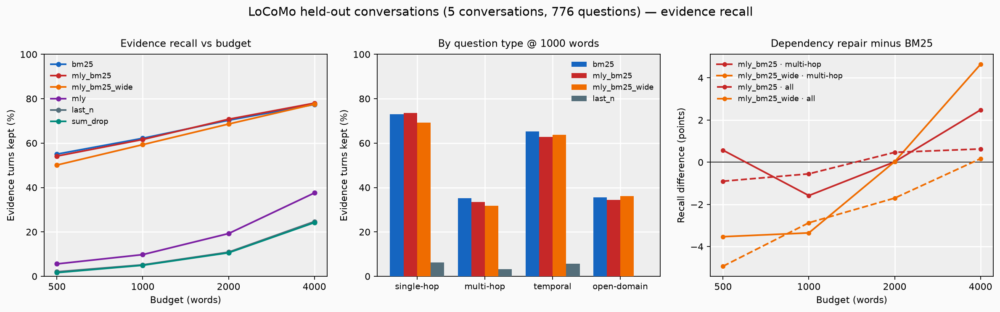
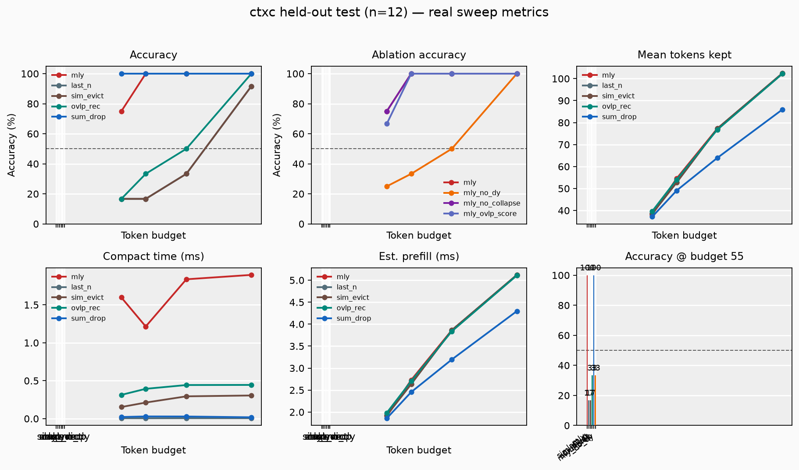
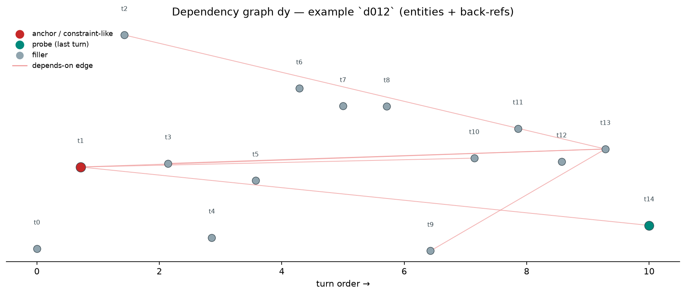

# ctxc

Dependency-aware context compaction for long conversations under a token budget.

When a chat history no longer fits, something has to go. `ctxc` builds a dependency graph between turns (`dy`: a later turn depends on the turn that introduced an entity it mentions) and, whenever it keeps a turn, keeps the turns it depends on too, or folds them into a one-line pin. The question is whether that beats plain ranking, so it is measured against BM25, last-N truncation and a few heuristics on a public benchmark and on a controlled synthetic suite.

[](https://github.com/REPLACE_ME/ctx-compact/actions/workflows/ci.yml)
[](https://colab.research.google.com/github/REPLACE_ME/ctx-compact/blob/main/notebooks/demo.ipynb)

```bash
pip install -e ".[dev]"
python -m pytest -v

python scripts/get_locomo.py          # LoCoMo, CC BY-NC 4.0, not vendored
python -m ctxc.eval.locomo --out results/locomo_sweep.csv
python scripts/plot_locomo.py

python -m ctxc.eval.run --split test --budgets 40,55,80,120
python scripts/export_and_plot.py
```

## Real conversations: LoCoMo

[LoCoMo](https://github.com/snap-research/locomo) has 10 long two-person conversations (369–689 turns, 9k–19k words) and ~2,000 questions, each labelled with the turns that hold its answer. A compactor is scored by **evidence recall**: the share of those turns still present after compacting the conversation to the budget. No model in the loop, so the number is about what the context keeps, not how well some LLM reads it.

Conversations 1–5 are the dev split, used once to pick the graph settings (entity document-frequency cap and parent depth, best mean recall over budgets). The figure and table are conversations 6–10, scored once afterwards. Adversarial questions (category 5) are excluded.



Held-out, 776 questions ([`results/locomo_sweep.csv`](results/locomo_sweep.csv)):

| method | 500 words | 1000 | 2000 | 4000 | multi-hop @ 4000 |
|--------|-----------|------|------|------|------------------|
| bm25 | 55.0 | 62.2 | 70.3 | 77.4 | 57.0 |
| mly_bm25 (BM25 rank + repair) | 54.1 | 61.6 | 70.8 | 78.0 | 59.4 |
| mly_bm25_wide (2-level repair) | 50.1 | 59.3 | 68.6 | 77.5 | 61.6 |
| mly (original overlap scorer) | 5.6 | 9.8 | 19.3 | 37.5 | — |
| last_n | 2.0 | 5.2 | 10.9 | 24.7 | — |
| sum_drop | 1.6 | 5.0 | 10.6 | 24.2 | — |

What this says:

- **Ranking matters far more than truncation policy.** Anything that keeps recent or keyword-flagged turns finds under 25% of the evidence even at 4,000 words. BM25 finds 55% at 500.
- **The original scorer does not transfer.** Word overlap normalised by turn length, plus a recency bonus, worked on the synthetic suite and collapses on natural chat. `mly_bm25` swaps in BM25 ranking so that the only difference from the `bm25` row is the dependency repair (with repair off it reproduces BM25 exactly; a test pins this).
- **Repair is a trade-off, not a free win.** Overall it lands within a point of BM25. At small budgets it spends words on parents instead of the next-best match and loses a little; at 4,000 words the 2-level setting lifts multi-hop recall from 57.0% to 61.6%. The multi-hop split is 140 questions, so read that as a signal, but dev pointed the same way (+3.4 points).

## Controlled suite: early constraint, late question

24 template dialogues (12 dev, 12 held out) where a rule stated early ("hard limit of 12 tokens per tool call") is asked about many turns later. Entities are extracted automatically; nothing is hand-labelled on the eval path. Scored by whether the constraint survives compaction (regex on an extractive stub answer).



At 55 tokens on the held-out set ([`results/bench_test_sweep.csv`](results/bench_test_sweep.csv)): `mly` 1.00, `mly_no_dy` 0.33, `last_n` 0.17, `sim_evict` 0.17. `sum_drop` also reaches 1.00 here because its keyword filter happens to match these rules, and it fails on LoCoMo for the same reason. This suite is built around the failure the method targets, so it shows the mechanism works, not that it generalises; LoCoMo is the test of that.

Dependency graph for one held-out dialogue (red: constraint-like anchor, teal: the late question):



## Method

1. Charge the pinned system text against the budget first.
2. Build `dy`: an edge from the turn that first introduced an entity to each later turn that reuses it, skipping speaker names and entities in more than `max_df` of turns. On the synthetic suite, back-reference cues ("as I said", "that limit") also link to earlier constraint-like turns.
3. Pick the best remaining turn (score per token, or BM25 rank), add its parents up to `max_depth` levels; if they do not fit whole, fold them into one-line pins.
4. Repeat until the budget is spent.

## Limits

- Evidence recall, not answer accuracy. The next step is feeding the compacted context to a fixed open model and scoring its answers against the LoCoMo gold answers.
- Budgets are in words; a real deployment should count with the serving model's tokenizer.
- Prefill time in the synthetic sweep is a linear estimate, not measured on a server.

## Layout

```
data/                  synthetic bench_dev / bench_test (LoCoMo downloads to data/locomo/)
results/               csv + png for both evals
notebooks/demo.ipynb   runs the tests and the synthetic sweep
scripts/               data generation, download, plotting
src/ctxc/              dy, mly, baselines, score
src/ctxc/eval/         synthetic and LoCoMo evals
tests/
```
ctxc compacts long chat histories to fit a fixed token budget without losing earlier constraints that later turns rely on. Keeping only the last N messages drops an early rule like "hard limit of 12 tokens per tool call" once the conversation gets long, so a later question about that limit can no longer be answered.

The selector builds a dependency graph between turns from reused entities and back-references ("as I said", "that limit"). It always keeps the system prompt, then fills the remaining budget by value per token. When it keeps a turn, it also keeps the earlier turns that turn depends on, or shortens them to a one-line pin.

It's evaluated on 24 synthetic dialogues (12 tuned on, 12 held out) at budgets from 40 to 120 tokens. At 55 tokens on the held-out set, ctxc kept the constraint in 100% of dialogues, against 17% for keeping the last N messages and 33% with dependency tracking switched off. An extractive summary baseline also scored 100% on this suite. Everything runs offline with no API key, and CI runs the tests and the evaluation on every push.
